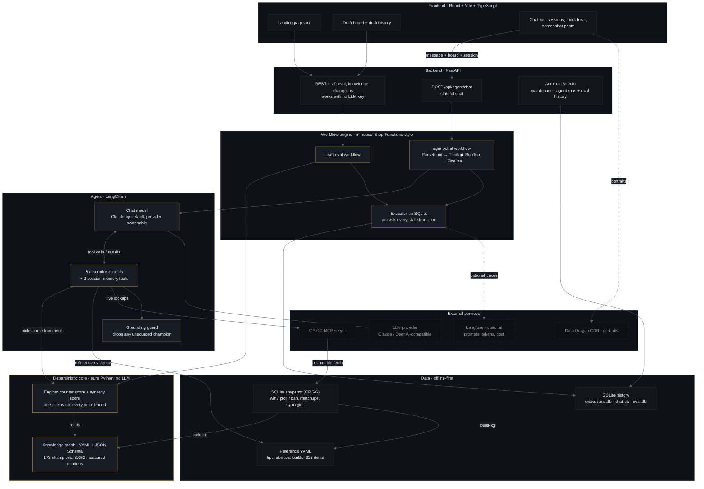
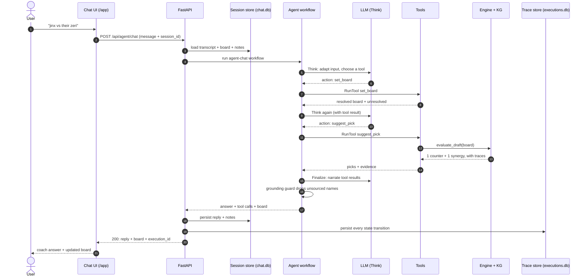

# LoL Coach

## What is a League of Legends draft?

League of Legends is a 5v5 game where two teams take turns picking and banning
champions before the match. Skills make some matchups favourable (**counters**)
and some allies combine well (**synergies**), so the order of picks matters.

## What is LoL Coach?

LoL Coach answers one question during a draft: **what should I pick, and why?**
It returns exactly two recommendations — one **counter-pick** against the enemy
team and one **synergy-pick** to fit your allies — each with evidence you can
inspect down to the raw statistic.

## What makes it different?

The design separates the **data** from the **agent**, and puts a deterministic
engine between them.

- **A separate data pipeline.** Real, aggregated match statistics are pulled from
  OP.GG into a SQLite snapshot. `build-kg` turns that snapshot into a versioned
  YAML knowledge graph: 173 champions and 3,052 measured relations (998 counters,
  2,054 synergies). Each edge is weighted by win-rate delta × sample size and
  carries a statistical reason. Counter direction is **derived from the measured
  win rate**, not hand-labelled.
- **A deterministic engine, not a guess.** The engine scores every legal champion
  from the knowledge graph and returns one counter-pick and one synergy-pick.
  Every point carries a `TraceLine(source, text, delta)`, so any recommendation
  can be explained and debugged.
- **The agent does everything else.** An LLM (Claude by default) adapts loose
  input ("jinx vs zeri", or a screenshot), orchestrates the tools, and writes the
  coach answer. It is structurally forbidden from deciding: picks come only from
  `suggest_pick`, and a grounding guard drops any reply that names a champion no
  tool produced.

**Why this matters:** a general LLM answers from training data that is frozen
months behind the live patch, and it can invent a matchup that does not exist.
Here the numbers come from a versioned snapshot you can refresh, and every number
is traceable to its source.

## Why not just use ChatGPT or Gemini?

| | ChatGPT / Gemini | LoL Coach |
|---|---|---|
| Data | frozen at the model's training cut-off | a versioned snapshot you can refresh |
| Picks | a list of options, may be invented | exactly one counter + one synergy, computed |
| Evidence | prose, unauditable | every point source-tagged and inspectable |
| Consistency | varies per prompt | same board → same answer, deterministic |
| Hallucination | possible | structurally blocked by the grounding guard |

A general assistant can *talk* about League. LoL Coach can *show its work* on a
pinned, versioned patch.

## Architecture

Layered, with one invariant: the only route from the language model to a draft
fact is through a tool result.



### Request flow

One chat turn, end to end. The model is consulted only for orchestration and
wording; every pick comes from the engine.



## Quick start

```bash
# backend
pip install -e ".[dev]"

# offline data backbone (run once; throttled + resumable)
python -m lolcoach.cli fetch --limit 40      # OP.GG pull -> data/snapshot.db
python -m lolcoach.cli build-kg              # snapshot -> knowledge/seed/*.yaml
                                             #   (graph + tips/abilities/builds/items)
python -m lolcoach.cli kg-report             # review the graph in a browser

# configure a model (required for chat — see below)
cp .env.example .env

# run
uvicorn lolcoach.main:app --reload            # API on http://127.0.0.1:8000

# frontend
cd frontend && pnpm install && pnpm dev       # http://localhost:5173 (chat at /app,
                                              #  agent tooling at /admin)

# verify
bash init.sh                                  # ruff + mypy + pytest
curl -s http://127.0.0.1:8000/api/health      # {"status":"ok",...}

# evaluate the agent (requires a model) — golden scenarios, rule-based scoring
python -m lolcoach.cli eval                   # exits non-zero if any scenario fails

# maintenance agents: fix a labelled issue, or review a PR (needs a model + gh)
python -m lolcoach.cli agent-fix --issue 12 --repo owner/name --workdir .
python -m lolcoach.cli agent-review --pr 34 --repo owner/name --workdir .
python -m lolcoach.cli eval-agents            # hermetic: no model, no network

# optional: run the whole stack in containers (needs Docker)
docker compose up --build                     # API on :8000, web on :8080

# optional: AI observability — prompts, tokens, and cost per run (needs Docker)
bash scripts/langfuse.sh up                   # Langfuse UI on http://localhost:3000
```

The agent suite lives in `evals/scenarios.yaml` and drives the real chat
tool-loop, scoring tool choice, board resolution, grounding, and engine fidelity.
See [`docs/RELIABILITY.md`](docs/RELIABILITY.md#agent-evaluation).

With a Langfuse server running and `LANGFUSE_*` set in `.env`, every chat turn is
recorded as one trace — each model call's prompt, completion, tool calls, token
usage, and cost — grouped by conversation. It is opt-in and side-effect-free: with
no credentials it is a no-op and the app is unchanged. See
[`docs/RELIABILITY.md`](docs/RELIABILITY.md#ai-observability-langfuse).

### Configure a model

Chat requires a model. Put the credentials in `.env` (copied from `.env.example`);
the app loads `.env` with `override=True`, so the value there always wins over your
shell. Any OpenAI-compatible endpoint works — point `LOL_COACH_LLM_BASE_URL` at it:

```bash
LOL_COACH_LLM_PROVIDER=openai                       # or: anthropic
OPENAI_API_KEY=sk-...                               # key for the selected provider
LOL_COACH_LLM_BASE_URL=https://openrouter.ai/api/v1 # e.g. OpenRouter; omit for the real API
LOL_COACH_LLM_MODEL=deepseek/deepseek-v4.1-flash
# ANTHROPIC_API_KEY=sk-...                          # when provider=anthropic
# LOL_COACH_LLM_EXTRA_HEADERS={}                    # JSON object; headers for a gateway/proxy
# LOL_COACH_ENABLE_VISION=true                      # image input
# LOL_COACH_MAX_TOOL_CALLS=8                        # tool-loop round-trip budget
# LOL_COACH_ENABLE_LIVE_TOOLS=true                  # rank + lane-matchup lookups (network)
# LOL_COACH_LIVE_REGION=NA                          # default region for a Riot-ID lookup
```

The endpoint is always sent explicitly, so an ambient `ANTHROPIC_BASE_URL` /
`OPENAI_BASE_URL` cannot silently redirect your credentials.

Without a key, `POST /api/agent/chat` returns `503` without starting a run; if the
provider errors at the **Think** step, the execution is marked **failed** and no
answer is returned. Nothing is answered from the model's own League knowledge and
nothing is fabricated offline. The engine, the traces, and the Trace Inspector
never depend on the model.

## Agents

This is a **disciplined agent design**: it never decides
(picks come only from the engine), its loop is a first-class workflow rather than a
framework black box, and every step is persisted and inspectable.

The agent is the orchestration layer, and it is deliberately narrow — it exists for
the three jobs the engine cannot do:

- **adapt** fuzzy human input (shorthand, typos, prose, a draft screenshot) into the
  engine's strict input;
- **orchestrate** the deterministic tools, in whatever order the question needs;
- **narrate** the tool results in coach voice.

It is forbidden from deciding: the single counter-pick and single synergy-pick come
only from `suggest_pick`. The system prompt states this, and the grounding guard
(`unsourced_champions`) enforces it structurally by discarding any reply that names
a champion absent from the tool results.

The loop runs as a first-class workflow, not a framework black box, so every step is
recorded and visible in the Trace Inspector:

```
ParseInput ─► Think ─► Route ──tool──► RunTool ─┐
                 ▲                             │
                 └─────────────────────────────┘
                          │ final
                          ▼
                      Finalize ─► Succeeded
                          │ over max_tool_calls
                          ▼
                      MaxSteps (Fail)
```

`Think` is the only place the model is consulted, and it is consulted about
orchestration, never about League. The agent is invoked through
`POST /api/agent/chat`; when a `session_id` is supplied the conversation and the
board live server-side in `data/chat.db`, and the session's transcript is the
agent's memory. Without a session the call is stateless and the client carries the
board between turns.

### Chat history & memory

Chat is organized into sessions (ChatGPT/Gemini style) with a session list in the
UI: create, reopen, rename, delete. Each session stores its transcript, board, and
the agent's notes, and is capped at **5 questions** (`LOL_COACH_MAX_QUESTIONS`) —
past the cap the API returns `409` and the UI locks the composer. The transcript
is replayed to the agent as context, and two memory tools — `recall_history` and
`remember` — let it re-read earlier turns and keep durable notes for the session.
No authentication: sessions are trusted as-is.

## Maintenance agents

These are an **in-house, self-hosted coding agent** — the same category of tool as
GitHub Copilot's coding agent (read an issue, edit a checkout, verify, open a PR;
review a PR), built here instead of rented. The value is not raw control but
**guardrails, evaluation, and audit**: deterministic gates in code, a hermetic
scenario suite gated in CI, and a full trace of what each run investigated, planned,
and changed. The trade-off: ưe own the sandbox and operations so we need to optimize this.

Two agents work on this repository's own backlog, and both are workflows for the
same reason chat is — so every phase is a persisted state output you can inspect:

| Agent | Command | What it does | What it can never do |
|-------|---------|--------------|----------------------|
| Fixer | `agent-fix` | Investigates a labelled issue, plans, edits the checkout, verifies with `ruff`/`mypy`/`pytest`, opens a PR | Push to the base branch, touch a guarded path (CI, `.env`), open a PR that does not verify |
| Reviewer | `agent-review` | Reviews a pull request and submits `APPROVE` or `REQUEST_CHANGES` | Merge — a human merges |

The fixer only acts on an issue carrying `LOL_COACH_AGENT_ISSUE_LABEL`
(`agent-fix` by default); **only a human applies that label**, which is the gate
against acting on an untrusted issue body. The guardrails (label, guarded paths,
secret files, a command allowlist with read-only git, no push from the model) are
deterministic checks in the workflow's task bodies, not prompt instructions.

Because both are ordinary workflows, a run shows up in the Trace Inspector and in
Langfuse like any other; the admin surface at `/admin/agents` renders what the run
*investigated, planned, and changed*, not just that it finished. Seven hermetic
scenarios in `evals/agent_scenarios.yaml` gate all of it in CI — see
[`docs/MAINTENANCE_AGENTS.md`](docs/MAINTENANCE_AGENTS.md).

## Tools

The deterministic surface the agent orchestrates
(`src/lolcoach/agent/tools.py`, dispatched by `ToolBox`, schemas in `tool_specs()`):

| Tool | What it does | Notes |
|------|--------------|-------|
| `set_board` | Sets allies, enemies, both teams' bans, and open roles. Resolves loose names (aliases, typos, casing) to canonical slugs. | Returns the resolved board plus an `unresolved` list. The only fuzzy-input adapter. |
| `suggest_pick` | Runs the pure engine over the current board and returns the best counter-pick and synergy-pick with their evidence traces. | **The only source of a pick recommendation.** |
| `explain_matchup` | Returns the measured counter and synergy edges between two champions, optionally in a specific role. | Evidence only — never a recommendation. |
| `get_champion` | Returns a champion's roles and win/pick/ban rates from the snapshot. | Reference data, no scoring. |
| `get_champion_tips` | Returns a champion's tips (how to play with and against), abilities, and lore. | Materialized reference data; advertised only when loaded. |
| `get_champion_build` | Returns a champion's recommended items, runes, and skill order for a role. | Materialized reference data; advertised only when loaded. |
| `get_summoner_profile` | Returns a player's tier, division, LP, and win/loss for a Riot ID. | **Live** (network). Identity only — never a champion pool. |
| `get_lane_matchup_guide` | Returns the written tip for one champion against one named opponent in a role. | **Live** (network). Evidence for the matchup the user named. |

Every tool wraps existing engine or knowledge logic; none of them is the LLM. The
two `get_champion_*` tools read the materialized reference YAML; the two live tools
call OP.GG on demand (disable with `LOL_COACH_ENABLE_LIVE_TOOLS=false`, in which
case they are not even advertised).

Tips and matchup prose can name *other* champions ("great against Yasuo"). To keep
the grounding guard meaningful, a result declares the champions it is entitled to
source (`ToolResult.sources`) and the guard whitelists only those — a mention in
prose never widens it.

## Stack

- **Backend / API** — Python 3.11+, FastAPI, Pydantic v2, Uvicorn.
- **Agent / LLM** — LangChain (`langchain-openai`, `langchain-anthropic`, imported
  lazily so the model is optional at import time); provider-neutral client seam in
  `agent/llm.py`.
- **Data / knowledge** — YAML knowledge graph validated against a JSON Schema;
  SQLite stdlib snapshot; source is the
  [OP.GG MCP server](https://github.com/opgginc/opgg-mcp) (Streamable HTTP, no auth).
- **Workflow / observability** — in-house Step-Functions-style executor on SQLite;
  structured JSON logging; the Trace Inspector reads the persisted event history.
- **AI observability** — optional Langfuse tracing at the model seam: one trace
  per agent run with each call's prompt, completion, token usage, and cost. Lazy
  and opt-in (no credentials ⇒ no-op, no import).
- **Frontend** — React 18, Vite 6, TypeScript 5, Tailwind 3.
- **Tooling & delivery** — `pytest`, `ruff`, and strict `mypy`, all wired through
  `init.sh` and enforced in CI (GitHub Actions: backend matrix 3.11/3.12, the
  hermetic maintenance-agent evaluation, frontend `tsc` + `vite build`, and both
  Docker image builds; the live chat evaluation is an opt-in job behind a secret).
  The API and web ship as two Docker images, run together with
  `docker compose up --build`.

## AI harness

This project was built with coding agents. The harness is the set of files and
checks that keeps them effective across sessions and keeps their work reviewable.

| Concern | Harness | What it guarantees |
|---|---|---|
| Contract | [`AGENTS.md`](AGENTS.md) | Startup order, layer boundaries, conventions, and the definition of done. Read before any code. |
| Progress | [`feature_list.json`](feature_list.json) | Every feature has a status and **evidence** — commands, tests, outputs. "Done" needs proof. |
| Continuity | [`session-handoff.md`](session-handoff.md) | What was accomplished, decisions, what remains, files, verification. The next session starts from this, not a blank prompt. |
| Quality gate | `bash init.sh` | ruff + strict mypy + pytest — the same gate CI runs. |
| Behavioural gate | `eval` / `eval-agents` | Golden scenarios scored by rules, not by taste. The maintenance suite is hermetic. |
| Review | [`clean-state-checklist.md`](clean-state-checklist.md) | End-of-session checklist: build, architecture, runtime, logging, data, performance, repo. |
| Process | Trace Inspector, `/admin`, Langfuse | Every state, tool call, and model call persisted, with Input / Output / Logs and Rerun. |

How a session runs:

1. Read `AGENTS.md`, the docs, `feature_list.json`, and `session-handoff.md`.
2. Run `bash init.sh` to confirm the baseline is green.
3. Implement, and update the docs + the feature's evidence in the same change.
4. Re-run `init.sh` and `eval-agents`; walk `clean-state-checklist.md`.
5. Append a handoff entry: accomplished, decisions, remains, files, verification.
6. CI runs the same gates on the PR.

The maintenance agents (`issue-fix`, `pr-review`) work under the same harness:
their guardrails are deterministic checks in code, and every phase is a persisted
state, so a run can be inspected after the fact rather than trusted.

Why this works: context survives the session boundary, results are backed by
evidence instead of claims, and the process itself is replayable — the Trace
Inspector and Langfuse show what actually ran.

## Docs

- [`docs/ARCHITECTURE.md`](docs/ARCHITECTURE.md) — layers, state machine, data flow
- [`docs/walkthrough.md`](docs/walkthrough.md) — scene-by-scene demo notes + screenshots
- [`docs/PRODUCT.md`](docs/PRODUCT.md) — features and non-goals
- [`docs/RELIABILITY.md`](docs/RELIABILITY.md) — logging, clean state, benchmarking
- [`docs/MAINTENANCE_AGENTS.md`](docs/MAINTENANCE_AGENTS.md) — the issue-fixer and
  PR-reviewer agents, their guardrails, and how to monitor and evaluate them
- [`AGENTS.md`](AGENTS.md) — boundaries and conventions for coding agents

## Demo

A 2m46s walkthrough recorded from the running app and its real history.
Scene-by-scene notes: [`docs/walkthrough.md`](docs/walkthrough.md).

<video src="docs/demo/lol-coach-demo.mp4" controls width="100%"></video>

