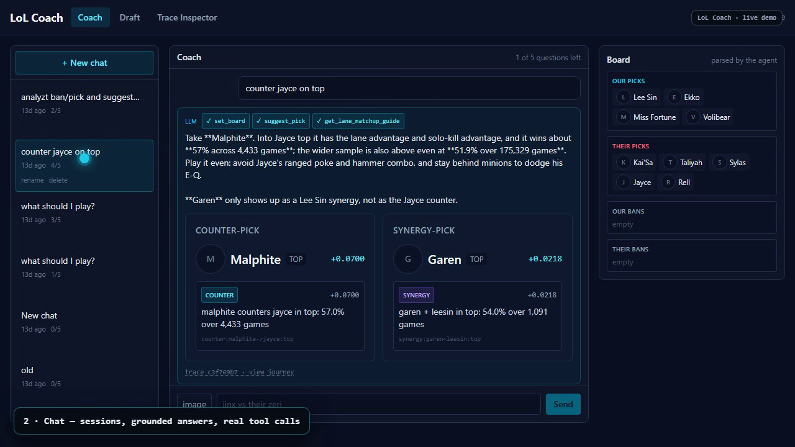

# Walkthrough

A 2m46s recording of the running system, using real chat sessions, real draft
history, and real maintenance-agent runs. No mock data and no staged screens.



Full video: [`demo/lol-coach-demo.mp4`](demo/lol-coach-demo.mp4) (H.264, 1280×720).

## What each scene shows

### 1. Chat — grounded tool calls

The session `counter jayce on top` is reopened. The agent calls `set_board`,
`suggest_pick`, and `get_lane_matchup_guide`, then answers with **Malphite** as
the counter (+0.0700, 57.0% over 4,433 games) and **Garen** as the synergy
(+0.0218, 54.0% over 1,091 games). Each card cites its source edge, and the board
on the right is the state the agent parsed.

What to look for: the tool chips (`set_board`, `suggest_pick`, …) and the
`trace_… · view journey` link under the answer.

### 2. Draft board — deterministic evaluation

A draft is restored from history, then evaluated. The engine returns the same
shape of answer with no model involved. Same board → same answer.

What to look for: the full pick/ban state, the two recommendation cards, and the
history entry it was restored from.

### 3. Trace Inspector — the process, not just the result

The `draft-eval` execution is opened. The node graph shows every state
(`BuildCandidates → ScoreCounters → ScoreSynergies`), each with its status,
duration, and visit count. Selecting a node shows its **Input**, **Output**, and
**Logs**.

What to look for: the 19 persisted events for a 0.4s run, and the `Rerun`
button, which replays the stored input without mutating history.

### 4. Maintenance agents — agent work on the repo itself

A real `issue-fix` run is opened at `/admin/agents`. The panel shows the
**investigation**, **plan**, **change**, and **verification** phases above the
run's state graph. A guard trip or failed verification ends the run at `Blocked`
with a reason.

What to look for: the investigation text (confidence and the files read) and the
timeline (`EXECUTION_STARTED → LoadIssue → Investigate`).

### 5. Evaluation — rules, not taste

`/admin/evaluation` lists suite runs; the selected run shows **7/7 passed** with
every check expanded. The negative scenarios pass by *refusing* correctly — a
failed run can be the expected result.

What to look for: the per-scenario check lists (`status`, `states`, `pr_opened`,
`verification_passed`, …) and the `Show trace` links.

### 6. Langfuse — every model call recorded

Two projects are shown:

- **LoL Coach** — one trace per chat (`agent-chat`, 14.47s, 7k tokens) with a
  `ChatOpenAI` generation per model call.
- **maintenance agent** — the full `issue-fix` run (4m47s, 1M tokens), with the
  system prompt, user issue, tool calls, tokens, and cost per call.

What to look for: the generation tree with token counts, and the model name on
each call.

## Reproduce it

```bash
# whole stack in Docker: app on :8080, Langfuse on :3000
bash scripts/start.sh

# or run the frontend locally against a local API
uvicorn lolcoach.main:app --reload
cd frontend && pnpm install && pnpm dev
```

Open a chat session, restore a draft, and inspect the trace. Send one chat
message first if this is a fresh install — the Trace Inspector and Langfuse only
show runs that actually happened. Langfuse sign-in for the local stack:
`dev@lolcoach.local` / `lolcoach`.
